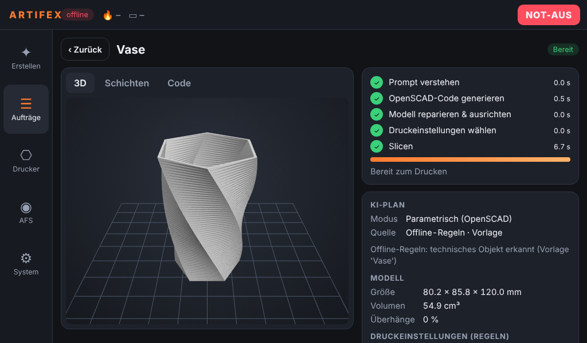

# ARTIFEX 🖨️

**ARTIFEX** is a fully custom-built CoreXY 3D printer with an integrated AI pipeline — type a description, and ARTIFEX generates and prints a 3D model. No CAD skills required.

> Built by Malte, Leo and Bo · Jugend Forscht 2027 · First prototype planned: February 2027

---

## What is ARTIFEX?

Most 3D printers require you to either download a ready-made model or design one yourself in CAD software. ARTIFEX removes that barrier entirely. Its AI pipeline takes a text prompt, automatically decides how to best generate a printable 3D model, and sends it straight to the printer via a custom slicer.

> 🚧 **Early development** — 3D model generation pipeline is just getting started. First full prototype targeted for February 2027.

---

## Features

### 🤖 AI Model Generation Pipeline

The pipeline starts with a prompt. An AI model (via OpenAI API — running locally or in the cloud) refines the prompt and decides whether the object is best represented as **organic** or **parametric**:

- **Organic path:** [z-image-turbo](https://huggingface.co/) generates an image → [Hunyuan3D-2.1](https://github.com/Tencent/Hunyuan3D-2) converts it to a 3D mesh
- **Parametric path:** AI generates OpenSCAD code directly for precise, dimension-accurate objects

Both paths feed into a **local custom slicer** with AI-assisted print settings.

```
              Prompt
                │
                ▼
    AI Model (prompt refinement)
    decides: Organic or Parametric?
    (via OpenAI API — local or cloud)
               / \
              /   \
             ▼     ▼
     Z-Image Turbo   AI generates
    (generates image)   OpenSCAD
             │               │
             ▼               │
       Hunyuan3D-2.1         │
             │               │
             └──────┬────────┘
                    ▼
        Local Slicing (custom slicer)
          with AI-assisted settings
                    │
                    ▼
                ARTIFEX 🖨️
```

### 🔩 Custom CoreXY Hardware
- **Frame:** 4040 aluminum extrusion — stiff, fast, scalable
- **Bed:** Ender 3 heated bed (235 × 235 mm), Z-axis only (no bed slinger)
- **Mainboard:** BTT SKR Pico Mini
- **Hotend:** E3D V6
- **Extruder:** Direct Drive
- **Motors:** NEMA17
- **Firmware:** Klipper

### 🧲 Modular Magnetic Toolhead
The toolhead uses a magnetic quick-swap system — different tools can be attached and detached in seconds without screws or manual wiring.

### 🎨 ARTIFEX Filament System (AFS)
ARTIFEX runs its own **magnetic modular filament system** — a fully custom alternative to proprietary solutions like Bambu's AMS. The AFS handles multi-material and color changes mid-print and is designed to be open, modular, and extendable. Modules connect magnetically and can be rearranged or expanded freely.

### 🌬️ HEPA + ACF Filtration
Integrated dual-stage filtration captures ultrafine particles and VOCs — important for enclosed printing with engineering filaments.

### 🖥️ ARTIFEX Software System

Everything runs on the Raspberry Pi inside the printer, with a touch display as the main interface:

- **Touch UI** (Chromium kiosk) – type a prompt on the on-screen keyboard, watch the pipeline, rotate the 3D preview, scrub through the sliced layers, start/pause prints, manage AFS slots and swap tools. The same UI works from any phone or PC in the LAN.
- **AI pipeline** – prompt routing, OpenSCAD code generation with automatic error repair, image-to-3D via a GPU inference server, mesh repair & auto-orientation, AI-assisted print settings, iterative edits ("make it twice as tall").
- **ARTIFEX Slicer** – in-house slicer (perimeters, top/bottom detection, grid/triangle infill, supports, brim, AFS colour changes) producing Klipper G-code; OrcaSlicer CLI as alternative backend.
- **Klipper configuration** – SKR Pico + CoreXY config and macros for print start/end, the AFS (manual or motorised), the magnetic toolhead and the HEPA/ACF filter, validated in Klipper's batch mode.
- **Works offline** – without internet ARTIFEX falls back to rule-based routing and parametric templates.



➡️ **Full documentation: [docs/SOFTWARE.md](docs/SOFTWARE.md)** (architecture, installation, configuration, API, tests)

```bash
# on the Raspberry Pi (Klipper + Moonraker installed via KIAUH)
git clone https://github.com/DerRobba/ARTIFEX.git ~/ARTIFEX && ~/ARTIFEX/deploy/install.sh
```

---

## Hardware Overview

| Component | Part |
|---|---|
| Frame | 4040 aluminum extrusion |
| Kinematic system | CoreXY |
| Bed | Ender 3 (235 × 235 mm, heated) |
| Mainboard | BTT SKR Pico Mini |
| Hotend | E3D V6 |
| Extruder | Direct Drive |
| Motors | NEMA17 |
| Firmware | Klipper |
| Filtration | HEPA + ACF |
| Toolhead mount | Magnetic quick-swap |
| Multi-material | ARTIFEX Filament System (AFS) |

---

## Tech Stack

| Layer | Technology |
|---|---|
| Prompt refinement & routing | AI model via OpenAI API (local or cloud) |
| Image generation | z-image-turbo |
| 3D mesh generation | Hunyuan3D-2.1 |
| Parametric models | OpenSCAD + AI codegen |
| Slicing | Custom slicer (in-house) and Orca Compatibility |
| Printer firmware | Klipper / Moonraker |
| Host software | Python (FastAPI, trimesh, shapely) on Raspberry Pi |
| Display | Touch UI in Chromium kiosk (cage / Wayland) |
| GPU inference | FastAPI server (diffusers + Hunyuan3D-2.1) on a CUDA PC |

---

## Roadmap

- [ ] Hardware design & component selection (in progress)
- [ ] CoreXY frame assembly
- [ ] Klipper firmware setup — *configuration & macros written, calibration on the real machine pending*
- [ ] AFS (ARTIFEX Filament System) — magnetic modular design — *software (manual + motorised mode) ready, hardware pending*
- [x] AI pipeline — prompt routing (organic vs. parametric)
- [ ] z-image-turbo + Hunyuan3D-2.1 integration — *inference server written, needs testing on a GPU machine*
- [x] OpenSCAD code generation integration
- [x] Custom slicer development (v0.1)
- [x] Touch display UI + Raspberry Pi installer — *first run on the real Pi pending*
- [ ] **First full prototype — February 2027** 🎯

---

## Team

Built by Malte, Leo and Bo for **Jugend Forscht 2027**.
