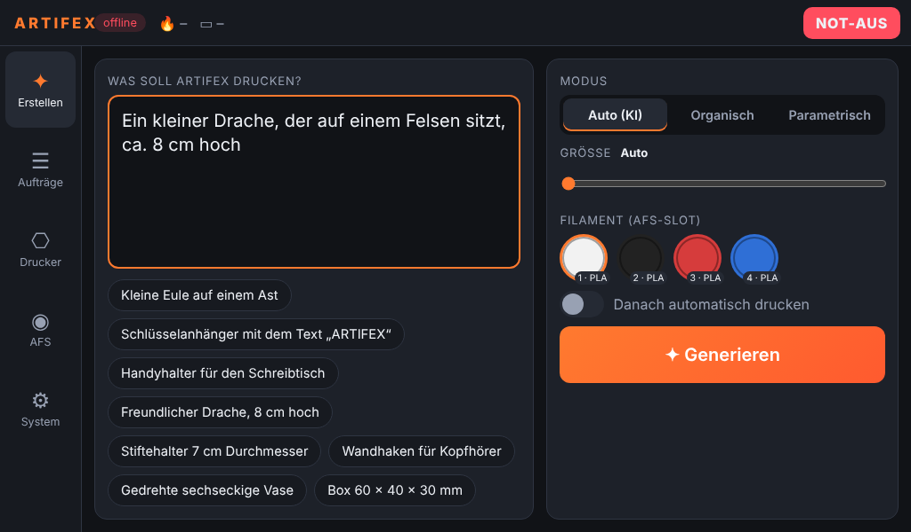
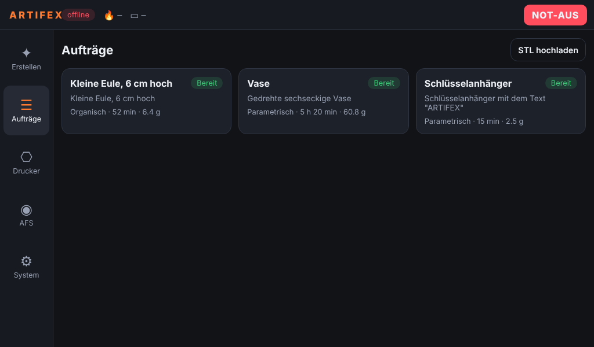
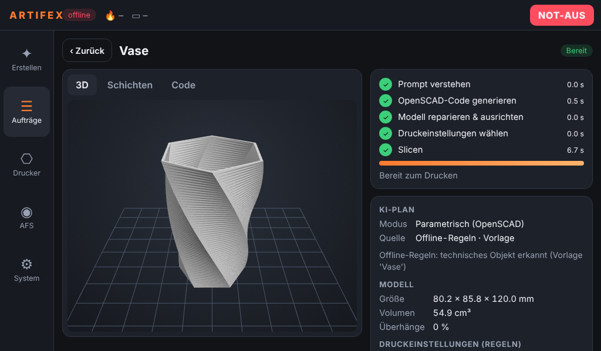
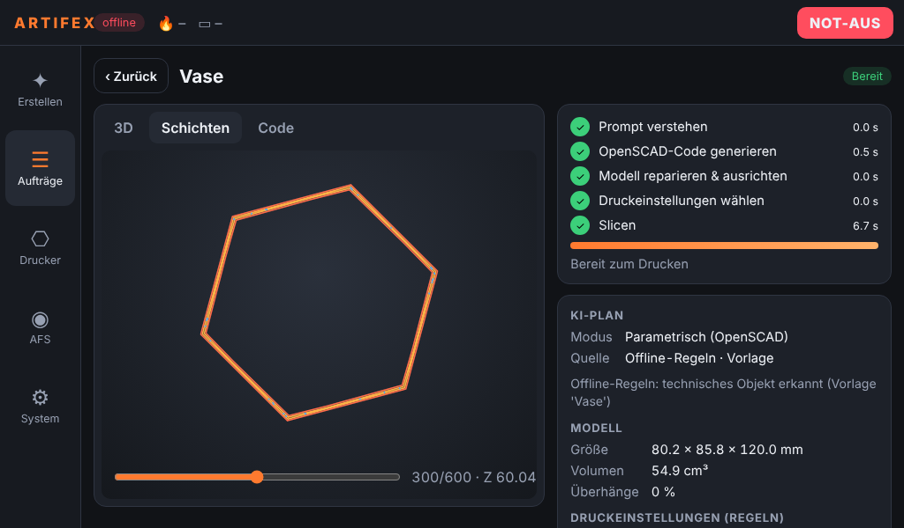
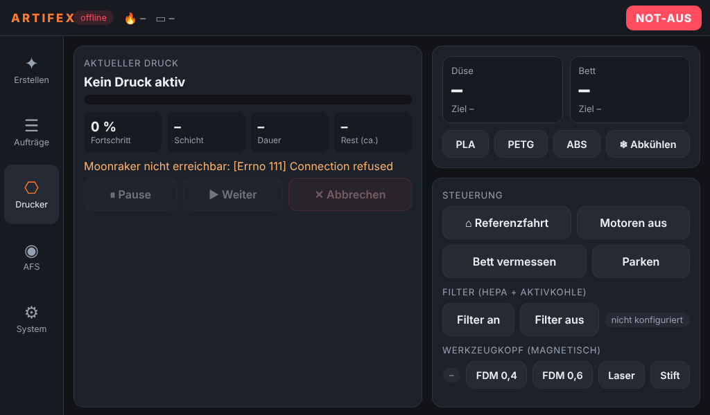
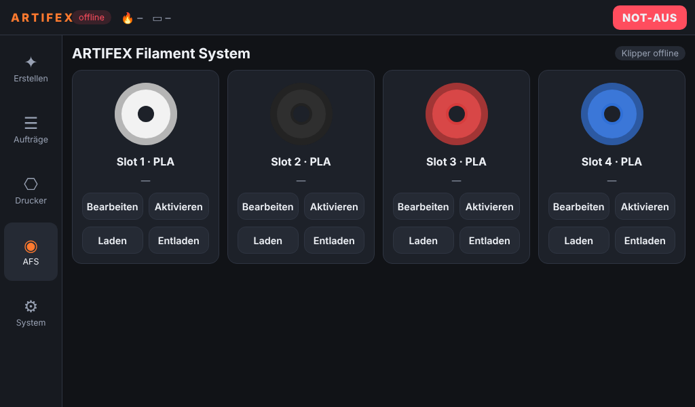

# ARTIFEX Software System

This document describes the complete ARTIFEX software stack: the host software on the
Raspberry Pi (AI pipeline, in-house slicer, Klipper/Moonraker bridge, touch UI), the Klipper
configuration for the printer and the GPU inference server for the organic path.



---

## 1. Architecture

```
 ┌─────────────────────────── Raspberry Pi (in the printer) ───────────────────────────┐
 │                                                                                      │
 │  Touch display ── Chromium kiosk (cage) ──┐        Mainsail/Fluidd (optional)        │
 │  LAN browsers / phones ───────────────────┤                │                        │
 │                                           ▼                ▼                        │
 │                      ARTIFEX host (FastAPI, :8080)      Moonraker (:7125)             │
 │                      ├─ Job manager (SQLite)               │                        │
 │                      ├─ AI pipeline ───────────────────────┼──► LLM (OpenAI API,     │
 │                      │   router · OpenSCAD codegen ·       │      local or cloud)    │
 │                      │   AI print settings                 │                        │
 │                      ├─ OpenSCAD (local)                   │                        │
 │                      ├─ Mesh repair / orientation          ▼                        │
 │                      ├─ ARTIFEX Slicer / OrcaSlicer CLI   Klipper ──USB──► SKR Pico  │
 │                      └─ Moonraker client ─────────────────►  (macros: PRINT_START,  │
 │                                                              AFS, toolhead, filter) │
 └───────────────────────────────────────┬──────────────────────────────────────────────┘
                                         │ HTTP (LAN / internet)
                         ┌───────────────▼────────────────┐
                         │ GPU inference server (PC/cloud) │
                         │  z-image-turbo   text → image   │
                         │  Hunyuan3D-2.1   image → mesh   │
                         └────────────────────────────────┘
```

### Pipeline stages

| # | Stage | Module | What happens |
|---|---|---|---|
| 1 | **Prompt verstehen** | `artifex/pipeline/router.py` | LLM refines the prompt and decides **organic** vs **parametric**, size, material, image prompt / engineering spec. Offline: keyword rules + built-in templates. User choices (mode, size) always win. |
| 2a | **OpenSCAD-Code** (parametric) | `pipeline/parametric.py` | LLM writes OpenSCAD → sandbox check (no `import()`, no file includes) → OpenSCAD renders STL → geometry check (fits bed, not empty, not below z=0). Errors are fed back to the LLM (up to `max_attempts`). Fallback: matching built-in template. |
| 2b | **Bild** (organic) | `pipeline/organic.py` | z-image-turbo renders a single object on white background (prompt rules make it 3D-friendly). |
| 2c | **3D-Modell** (organic) | `pipeline/organic.py` | Hunyuan3D-2.1 turns the image into a mesh (background removal, floater removal, face reduction on the GPU server). |
| 3 | **Modell vorbereiten** | `pipeline/mesh.py` | Repair (merge, remove fragments, fill holes, voxel remesh if still open), decimate, keep upright if stable else choose the stable pose with least overhang, scale, **flatten the base** of organic models, fit to build volume, center on bed. |
| 4 | **Druckeinstellungen** | `pipeline/settings_ai.py` | Rule-based baseline from mesh analysis (overhang ratio, slenderness, base area) + optional LLM refinement. Every value is clamped to safe limits (`slicer/settings.py: LIMITS`). Material comes from the selected AFS slot. |
| 5 | **Slicen** | `slicer/engine.py` / `slicer/orca.py` | In-house slicer or OrcaSlicer CLI. |
| 6 | **Drucken** | `printer/moonraker.py` | Upload to Moonraker + start, after the user confirms on the display (or automatically with `auto_print`). |

Each job keeps all intermediate artefacts in `~/printer_data/artifex/jobs/<id>/`
(`image.png`, `model.scad`, `source.stl`, `print.stl`, `print.gcode`).

**Iterative design:** "Ändern" on the display creates a child job with feedback text
("doppelt so hoch", "Wände dicker"). The router updates the previous plan, and the code
model receives the previous OpenSCAD code + feedback, so parametric parts are *edited*
instead of regenerated from scratch.

### The ARTIFEX Slicer

`artifex/slicer/engine.py` is a complete, dependency-light planar slicer (trimesh + shapely):

* sections every layer at mid-height, builds islands with holes
* perimeters (inner first, outer last), aligned rear seam, thin-feature fallback
* top/bottom detection: an area gets sparse infill only if it is covered by
  `top_layers` layers above **and** `bottom_layers` layers below; everything else is solid
* sparse infill patterns `grid`, `lines`, `triangles` (anchored to the bed origin so layers
  stack), solid infill alternating 45°/135°, greedy nearest-neighbour path ordering
* supports: per-layer overhang detection (`support_angle`), support columns accumulated
  top-down that rest on the bed or the model, XY gap and Z gap
* skirt, brim, retraction with Z-hop, cooling with first-layer delay, minimum layer time
* AFS colour changes at given heights (`AFS_CHANGE SLOT=n`)
* Klipper-specific output: `PRINT_START …`, `SET_PRINT_STATS_INFO`, `M73` progress,
  `;TYPE:`/`;LAYER_CHANGE` markers (Orca-style, used by the layer preview)
* print-time estimate with a trapezoidal acceleration model (validated against Klipper's own
  simulation: within ≈ ±15 %)

The generated G-code is validated in CI-style tests by running it through **real Klipper in
batch mode** together with the ARTIFEX printer configuration (see §6).

---

## 2. Hardware / software requirements

| Part | Requirement |
|---|---|
| Raspberry Pi | Pi 4 (4 GB+) or Pi 5, Raspberry Pi OS Bookworm/Trixie **64-bit** |
| Display | any DSI/HDMI touch display (UI is designed for 800×480 … 1280×800) |
| Klipper stack | Klipper + Moonraker via [KIAUH](https://github.com/dw-0/kiauh); Mainsail/Fluidd optional |
| LLM | any OpenAI-compatible endpoint: OpenAI cloud, Ollama, llama.cpp, LM Studio, vLLM |
| GPU server (organic path) | Linux PC with NVIDIA GPU, ~24 GB VRAM for both models (`--low-vram` swaps them, ≥16 GB) |

Without LLM the system still works offline (keyword routing + parametric templates:
key tag, sign, box, cup, vase, wall hook, phone stand). Without GPU server only the
parametric path and STL uploads are available.

---

## 3. Installation

### 3.1 Raspberry Pi

```bash
# 1. Klipper + Moonraker (+ Mainsail) with KIAUH
git clone https://github.com/dw-0/kiauh.git && ./kiauh/kiauh.sh

# 2. ARTIFEX
git clone https://github.com/DerRobba/ARTIFEX.git ~/ARTIFEX
~/ARTIFEX/deploy/install.sh            # --no-kiosk for headless setups
```

The installer

* installs OpenSCAD, Chromium and the `cage` kiosk compositor,
* creates `~/artifex-env` and installs the host software,
* symlinks `klipper/artifex/` into `~/printer_data/config/` and copies `printer.cfg`
  and `artifex.yaml` (only if they do not exist),
* registers ARTIFEX in Moonraker's update manager (updates from Mainsail/Fluidd),
* installs `artifex.service` (backend on port 8080) and `artifex-kiosk.service`
  (fullscreen UI on tty1).

Then:

1. Flash Klipper to the SKR Pico (`make menuconfig`: RP2040, USB) and set the serial in
   `printer.cfg` (`ls /dev/serial/by-id/`).
2. Calibrate everything marked `>>> CALIBRATE <<<` (endstops, rotation distances, PID,
   pressure advance, probe offsets).
3. Put API keys into `~/printer_data/config/artifex.env`:
   ```
   OPENAI_API_KEY=sk-...
   ARTIFEX_INFERENCE_KEY=some-shared-secret
   ```
4. Edit `~/printer_data/config/artifex.yaml` (LLM endpoint, GPU server URL) and
   `sudo systemctl restart artifex`.

### 3.2 GPU inference server

```bash
cd ARTIFEX/inference_server
./setup.sh                                   # venv, torch, diffusers, Hunyuan3D-2.1
source .venv/bin/activate
ARTIFEX_INFERENCE_KEY=some-shared-secret python server.py --port 8765 [--low-vram]
```

`--mock` starts the server without GPU and returns placeholder images/meshes – useful to
demo or test the full organic flow on any laptop. A systemd unit is provided in
`inference_server/artifex-inference.service`.

| Endpoint | Input | Output |
|---|---|---|
| `GET /health` | – | model/GPU status |
| `POST /v1/image` | JSON `{prompt, width, height, steps, seed}` | PNG (Z-Image-Turbo, 9 steps, CFG 0) |
| `POST /v1/mesh` | multipart `image`, `steps`, `octree_resolution`, `max_faces`, `seed` | binary STL, Z-up |

### 3.3 Local LLM instead of cloud

```yaml
llm:
  base_url: http://192.168.1.50:11434/v1   # Ollama on the GPU PC
  model: qwen2.5-coder:14b
  json_mode: json_object
```

---

## 4. Configuration reference

See [`deploy/artifex.example.yaml`](../deploy/artifex.example.yaml) – every key is
documented there and optional. Notable options:

| Key | Default | Meaning |
|---|---|---|
| `auto_print` | `false` | start printing right after slicing (otherwise confirm on display) |
| `llm.codegen_model` | – | separate (stronger) model for OpenSCAD code |
| `llm.temperature` | unset | leave unset for reasoning models that reject it |
| `openscad.max_attempts` | 4 | compile/geometry repair rounds |
| `openscad.allowed_libraries` | `[]` | e.g. `["BOSL2/"]` |
| `slicer.backend` | `artifex` | or `orca` (OrcaSlicer CLI with exported profiles) |
| `slicer.ai_settings` | `true` | LLM may refine rule-based print settings |

**OrcaSlicer backend:** export a machine, process and filament profile from the Orca GUI and
reference them in `artifex.yaml`. The machine start G-code must call the ARTIFEX macro:

```
PRINT_START BED=[bed_temperature_initial_layer_single] EXTRUDER=[nozzle_temperature_initial_layer] MATERIAL={filament_type[initial_extruder]} SLOT={initial_extruder}
```

and the end G-code `PRINT_END`.

---

## 5. Klipper configuration

```
klipper/
├── printer.cfg            entry point (MCU serial, kinematics limits, virtual_sdcard …)
└── artifex/
    ├── hardware.cfg       SKR Pico pins, CoreXY steppers, TMC2209, E3D V6, bed, fans, LED
    ├── z_switch.cfg       Z endstop switch            (default)
    ├── probe.cfg          BLTouch + bed mesh          (alternative to z_switch.cfg)
    ├── macros.cfg         PRINT_START/END, PAUSE/RESUME/CANCEL, park, purge, LEDs, M600
    ├── afs.cfg            ARTIFEX Filament System (manual mode)
    ├── afs_hardware.cfg   motorised AFS modules on a second MCU (hardware mode)
    ├── toolhead.cfg       magnetic quick-swap toolhead with per-tool offsets
    ├── filtration.cfg     HEPA + ACF filter fan with auto mode and run-on
    └── sensors.cfg        filament runout, toolhead presence (optional)
```

### Macro interface

| Macro | Purpose |
|---|---|
| `PRINT_START BED= EXTRUDER= SLOT= MATERIAL= FILTER=` | heat, home, mesh (if probe), filter auto-on for ABS/ASA, select AFS slot, purge |
| `PRINT_END` | retract, lower bed, present print, heaters off, filter run-on |
| `AFS_CHANGE SLOT=n` | switch filament (also mid-print, emitted by the slicer for colour changes) |
| `AFS_LOAD_CONFIRM` | manual mode: user inserted the filament → load, purge, resume |
| `AFS_LOAD SLOT=n` / `AFS_UNLOAD` / `AFS_STATUS` | slot handling |
| `TOOL_CHANGE TOOL=fdm\|fdm06\|laser\|pen` / `TOOL_CONFIRM` | guided magnetic tool swap with offsets |
| `FILTER_ON [SPEED=]` / `FILTER_OFF` | filtration |
| `M600` | filament change of the active slot |

**AFS modes.** In *manual* mode (default, no extra hardware) a colour change pauses the
print, unloads the filament and shows a dialog on the ARTIFEX display (and a Mainsail
prompt). In *hardware* mode (`[include artifex/afs_hardware.cfg]`) the motorised modules
retract and feed the filament automatically and the print continues without user
interaction. The slicer and host software use the same commands in both modes.

---

## 6. Development & tests

```bash
python3 -m venv .venv && . .venv/bin/activate
pip install -e ".[dev]" mapbox_earcut scikit-image fast_simplification manifold3d
sudo apt install openscad

pytest                              # unit + API tests (OpenSCAD tests skip if missing)
./scripts/validate-klipper.sh       # builds Klipper for RP2040 and runs printer.cfg,
                                    # all macros and real slicer output in klippy batch mode

# run everything locally without printer/GPU:
python inference_server/server.py --mock --port 8765 &
cat > artifex.yaml <<'EOF'
data_dir: ./data
llm: {enabled: false}          # or your endpoint
inference: {url: "http://127.0.0.1:8765"}
EOF
python -m artifex serve --port 8080      # open http://localhost:8080
python -m artifex generate "Kleine Eule, 6 cm hoch"   # pipeline in the terminal
python -m artifex slice model.stl -o model.gcode --supports
```

Test overview: LLM answer parsing, routing (LLM + offline rules), OpenSCAD repair loop and
sandbox, all templates render watertight, mesh repair/orientation/base flattening, slicer
(layer count, solid/sparse detection, supports, colour change, bed bounds, time model),
settings clamping, full REST/WebSocket API flows (parametric, organic with mock GPU server,
upload, reslice, feedback iteration, printing via a fake Moonraker), Klipper config checks.

### REST API (port 8080)

| Method | Path | |
|---|---|---|
| `GET` | `/api/system` | health of Klipper/Moonraker, LLM, GPU server, OpenSCAD |
| `GET/POST` | `/api/jobs` | list / create (`{prompt, mode, size_mm, slot, auto_print, parent_id, feedback}`) |
| `POST` | `/api/jobs/upload` | slice an uploaded STL/OBJ/3MF/GLB |
| `GET/DELETE` | `/api/jobs/{id}` | job details / delete |
| `POST` | `/api/jobs/{id}/print` · `/cancel` · `/reslice` | print, cancel, change size/settings |
| `GET` | `/api/jobs/{id}/files/{name}` | `image.png`, `model.scad`, `print.stl`, `print.gcode` … |
| `GET/POST` | `/api/printer` | status / actions (`pause`, `resume`, `cancel`, `estop`, `home`, `preheat`, …) |
| `GET/PUT/POST` | `/api/afs`, `/api/afs/{i}`, `/api/afs/{i}/{load\|unload\|select}` | AFS slots |
| `WS` | `/ws` | live events: `job`, `printer`, `afs` |

---

## 7. Screens

| | |
|---|---|
|  |  |
|  |  |
|  | |
